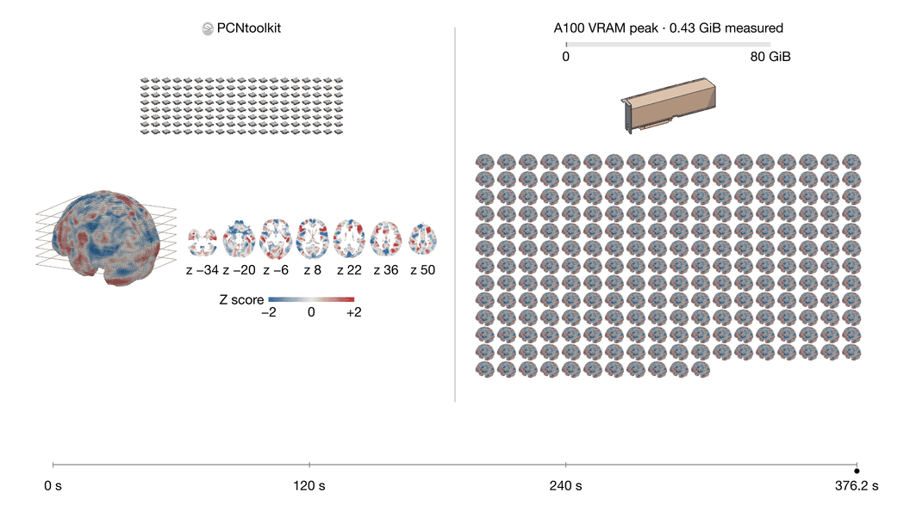
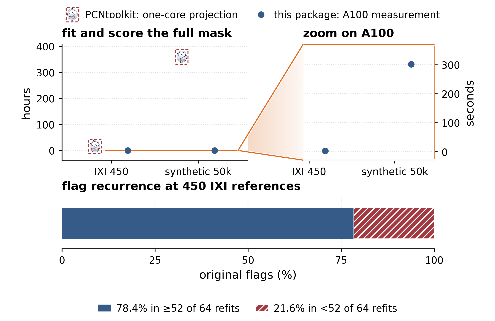
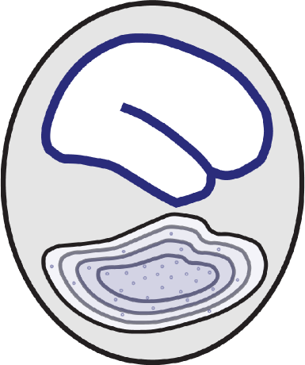

<p align="center"></p>

# voxelwise-normative-jax

batched JAX normative modelling for numeric response matrices, with or without imaging.

[](https://doi.org/10.5281/zenodo.24498156)

<a href="docs/assets/speed-race.gif"></a>
<p>the race scales a <a href="docs/figures/data/speed.csv">single-core cluster measurement</a> to 152 cores (376.2 s projected). the 227 icons show estimated completions at 1.655 s per run, the <a href="docs/figures/data/speed-and-error.csv">measured median for a 32-bit A100 fit and score</a> on the cluster. the 0.43 GiB <a href="docs/figures/data/speed-memory.csv">live memory peak</a> is from a separate A100 run and excludes unused reserved memory. the static plot uses separate 64-bit A100 timings. <a href="docs/licences.md#data">image licence</a></p>

<a href="docs/assets/exp_voxelwisenormative_010-result.png"></a>

on one NVIDIA A100, whole-mask fits were about 20,600× faster at 450 IXI references and 4,300× at 50,000 synthetic references against projected single-core PCNtoolkit times. the 450-reference A100 time was measured on a university HPC cluster, the 50,000-reference A100 time on a rented [Hugging Face Jobs](https://huggingface.co/docs/huggingface_hub/guides/jobs) A100. [all experiments](experiments/README.md)

## install

install with `python -m pip install .`.

## use

covariates and responses share rows. pass a boolean test mask and optional batch labels; omit `batch_levels` to learn levels from training rows.

<!-- readme-example -->
```python
import numpy as np
from shared.voxelwisenormative.model import fit_score

rng = np.random.default_rng(0)
exposure = np.linspace(-1.0, 1.0, 64)
x = np.column_stack((rng.normal(size=64), exposure))
batch = np.resize(["lab-a", "lab-b", "lab-c"], 64)
y = exposure[:, None] * np.array([0.6, -0.3]) + np.exp(exposure[:, None]) * rng.normal(size=(64, 2))
held = np.arange(64) % 4 == 0
z = fit_score(x, y, held, batch=batch, spline_column=1, chunk=2)
assert z.shape == y[held].shape and np.isfinite(z).all()
# Fit noise precision per response from the linear covariates and an intercept.
z_hetero = fit_score(x, y, held, batch=batch, spline_column=1, heteroskedastic=True, chunk=2)
assert z_hetero.shape == z.shape and np.isfinite(z_hetero).all()
# Automatic relevance determination: one prior precision per coefficient in the mean model.
z_ard = fit_score(x, y, held, batch=batch, spline_column=1, ard=True, chunk=2)
assert z_ard.shape == z.shape and np.isfinite(z_ard).all()
print(z.shape)
```
<!-- /readme-example -->

## with  PCNtoolkit

`fit_score` fits warped Bayesian linear regression (`BLR` in [PCNtoolkit](https://github.com/predictive-clinical-neuroscience/PCNtoolkit)): default, `heteroskedastic=True` or `ard=True`. independent fits with `ard=True` can give different z-scores ([experiments](experiments/README.md)).

`export_pcntoolkit` saves a default fit to a new folder that PCNtoolkit loads ([discussion](https://github.com/predictive-clinical-neuroscience/PCNtoolkit/issues/654)). install with `python -m pip install '.[pcntoolkit]'`.

```python
import pcntoolkit
from shared.voxelwisenormative.basis import Basis
from shared.voxelwisenormative.batched_blr import design, fit_chunks, make_fitter
from shared.voxelwisenormative.cohort import standardise
from shared.voxelwisenormative.pcntoolkit_export import export_pcntoolkit

basis = Basis.fit(x[~held], batch[~held], spline_column=1)
phi = design(basis.apply(x[~held], batch[~held]), basis.apply(x[held], batch[held]))
hyp, _, _ = fit_chunks(make_fitter(), phi, *standardise(y, held), chunk=2)
folder = export_pcntoolkit("pcn-model", basis, hyp, x[~held], y[~held], batch[~held])
model = pcntoolkit.NormativeModel.load(str(folder))
```

[licences](docs/licences.md): MIT; optional PCNtoolkit is GPL-3.0-only.

## documents

[context](docs/000-context.md) · [results](docs/004-results.md) · [open questions](docs/002-open-questions.md) · [decisions](docs/001-decisions.md) · [protocol](docs/003-experiment-protocol.md)
