# experiments

## against pcntoolkit

| experiment | result | time against PCNtoolkit | z agreement |
|---|---|---|---|
| [exp_002 optimiser step](exp_voxelwisenormative_002_pcntoolkit_cpu_baseline/README.md) | <a href="../docs/assets/exp_voxelwisenormative_002-result.png">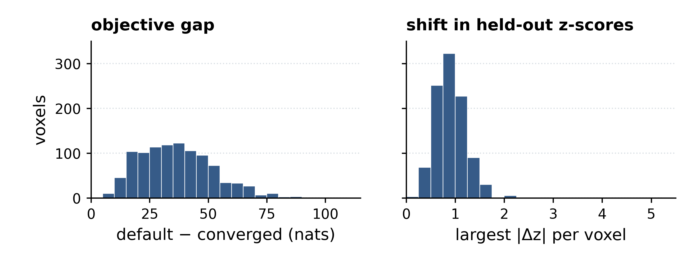</a> | — | — |
| [exp_003 batched fit](exp_voxelwisenormative_003_batched_jax_fit/README.md) | <a href="../docs/assets/exp_voxelwisenormative_003-result.png">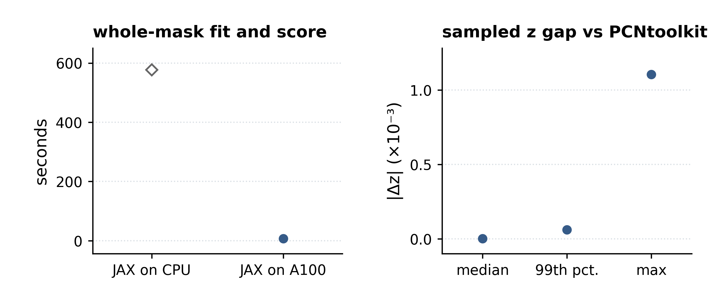</a> | — | 0.00110 max, sampled |
| [exp_007 whole-mask agreement](exp_voxelwisenormative_007_pcntoolkit_full_mask/README.md) | <a href="../docs/assets/exp_voxelwisenormative_007-result.png">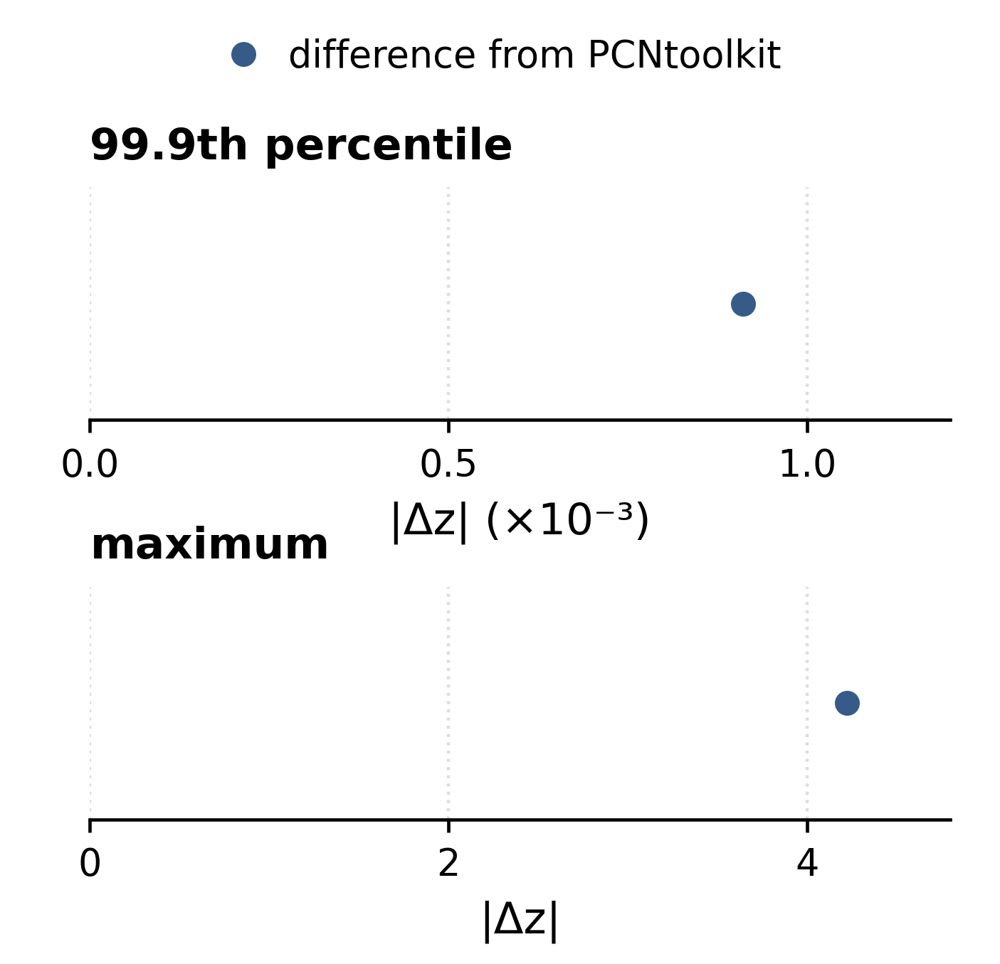</a> | — | 0.000911 at 99.9th percentile; 4.22 max |
| [exp_010 reference size](exp_voxelwisenormative_010_reference_size_scaling/README.md) | <a href="../docs/assets/exp_voxelwisenormative_010-result.png">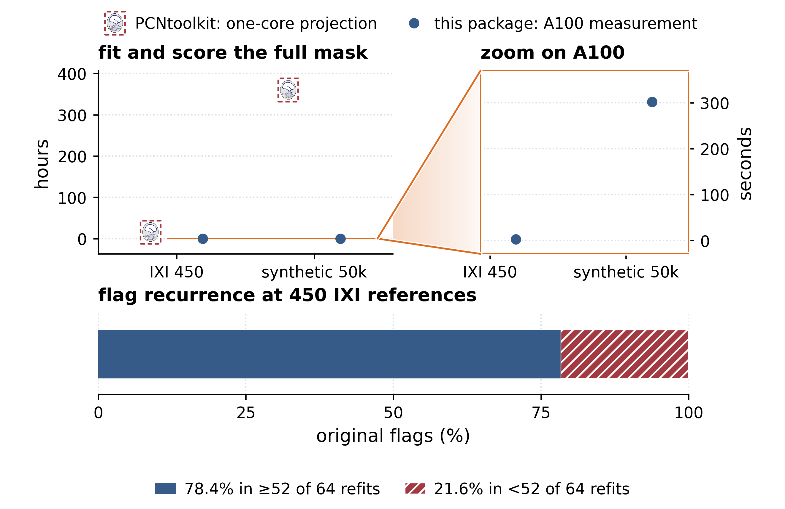</a> | 20,600× IXI; 4,300× synthetic, vs single-core projections | 0.00110 max, sampled IXI |

## against the original 64-bit jax fit

| experiment | result | time against the original fit | other measured result |
|---|---|---|---|
| [exp_004 early stop](exp_voxelwisenormative_004_speed_headroom/README.md) | <a href="../docs/assets/exp_voxelwisenormative_004-result.png">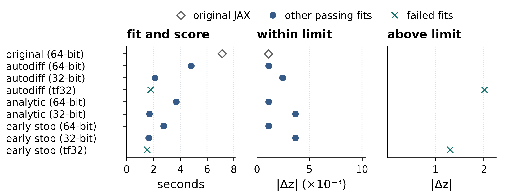</a> | 4.31× faster, fastest passing variant | max z difference from PCNtoolkit: 0.003664 |
| [exp_006 voxel scaling](exp_voxelwisenormative_006_speed_memory_scaling/README.md) | <a href="../docs/assets/exp_voxelwisenormative_006-result.png">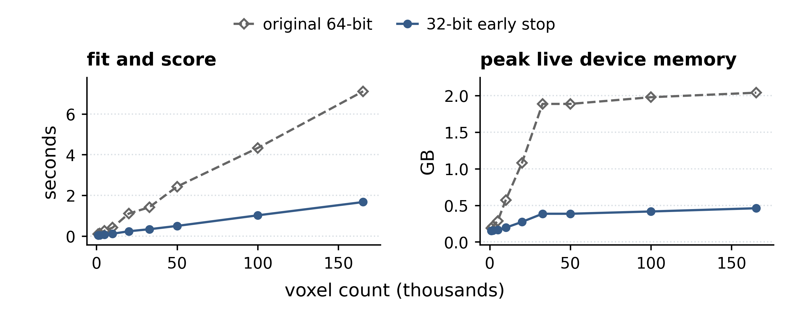</a> | 4.25× faster at full mask width | peak live device memory: 0.461 GB vs 2.040 GB |
| [exp_013 refit batching](exp_voxelwisenormative_013_gpu_headroom/README.md) | <a href="../docs/assets/exp_voxelwisenormative_013-result.png">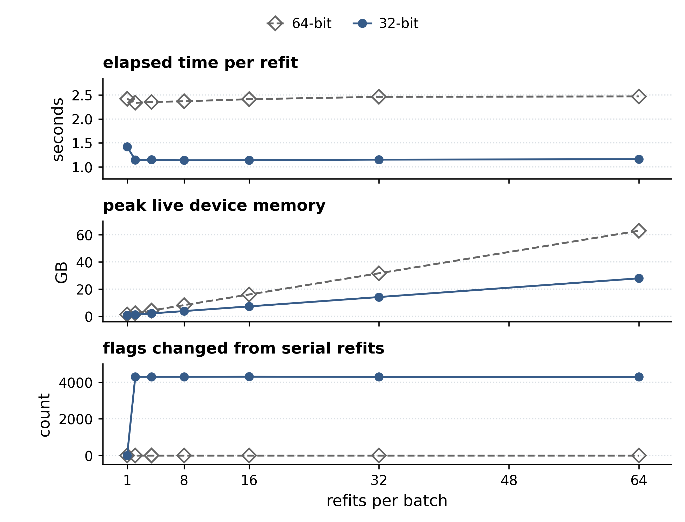</a> | 1.04× faster per 64-bit refit, batch of two vs one | no flag changes versus serial 64-bit refits |

## other experiments

| experiment | result |
|---|---|
| [exp_000 IXI reference](exp_voxelwisenormative_000_ixi_grey_matter_reference_chain/README.md) | — |
| [exp_001 voxel matrix](exp_voxelwisenormative_001_ixi_voxel_matrix/README.md) | — |
| [exp_005 flag recurrence](exp_voxelwisenormative_005_bootstrap_stability/README.md) | — |
| [exp_008 recurrence gap](exp_voxelwisenormative_008_unstable_pair/README.md) | — |
| [exp_009 held-out folds](exp_voxelwisenormative_009_crossfit_all_scans/README.md) | — |
| [exp_011 fragile clusters](exp_voxelwisenormative_011_fragile_clusters/README.md) | <a href="../docs/assets/exp_voxelwisenormative_011-result.png">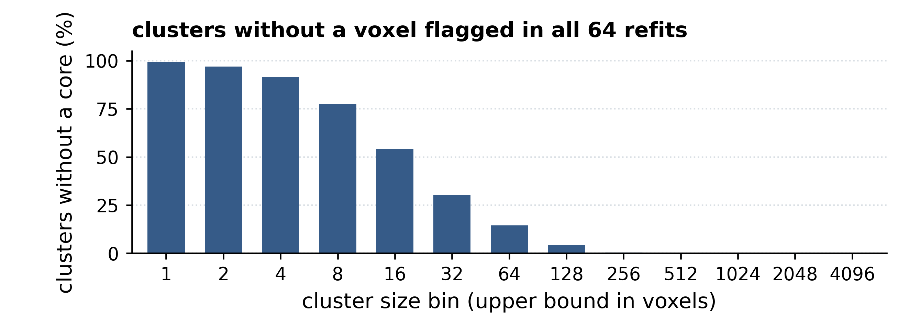</a> |
| [exp_017 SynthSR quality](exp_voxelwisenormative_017_ixi_synthsr_reference/README.md) | <a href="../docs/assets/exp_voxelwisenormative_017-result.png">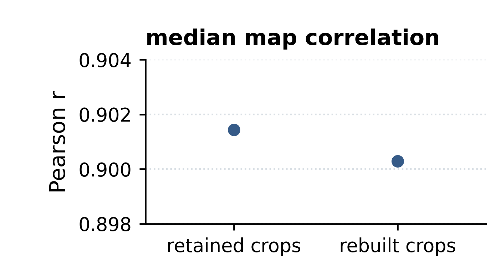</a> |
| [exp_020 heteroskedastic BLR](exp_voxelwisenormative_020_heteroskedastic_blr/README.md) | <a href="../docs/assets/exp_voxelwisenormative_020-result.png">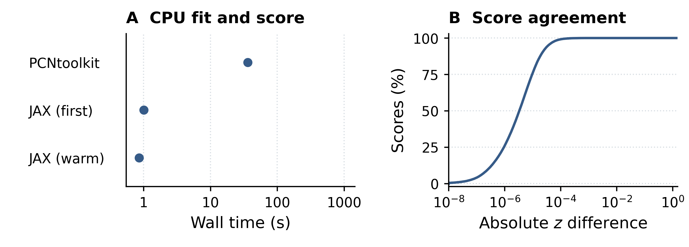</a> |
| [exp_021 automatic relevance determination](exp_voxelwisenormative_021_ard_blr/README.md) | <a href="../docs/assets/exp_voxelwisenormative_021-result.png">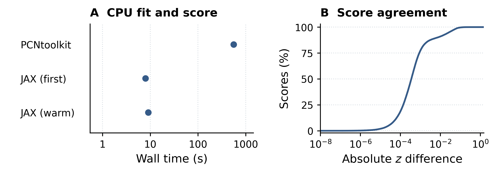</a> |
| [exp_022 PCNtoolkit model export](exp_voxelwisenormative_022_pcntoolkit_export/README.md) | <a href="../docs/assets/exp_voxelwisenormative_022-result.png">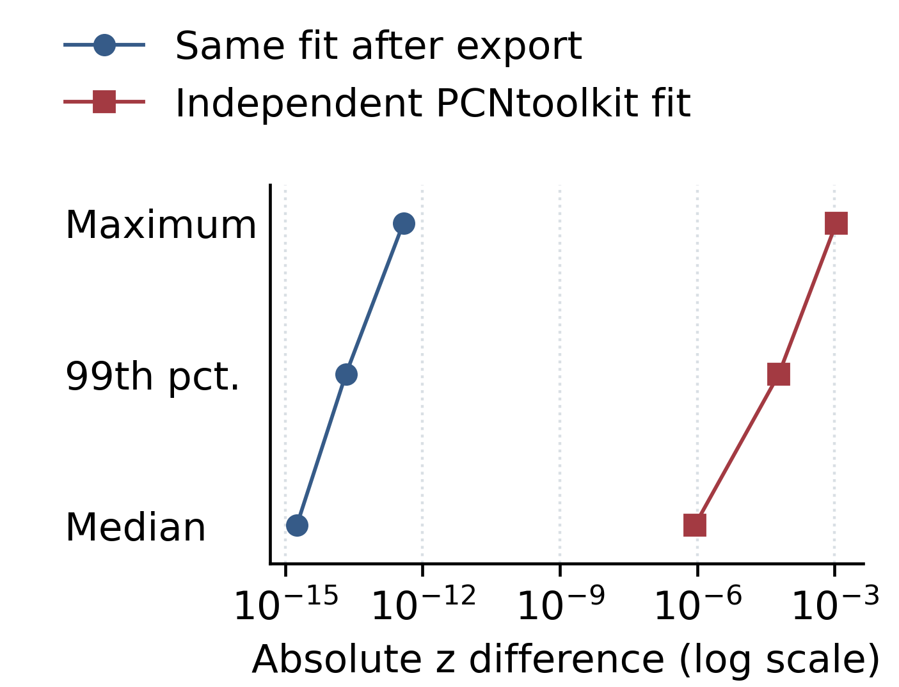</a> |

the z column reports absolute score differences, not correlations. see [results and comparison rules](../docs/004-results.md) · [figure sources](../docs/figures/README.md).
