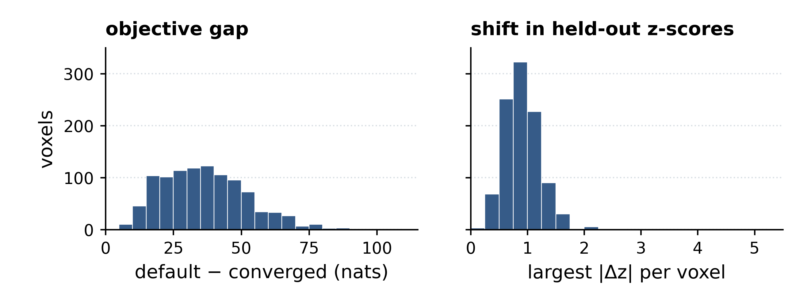

# exp_002 optimiser step

## does PCNtoolkit converge with its default optimiser step?

on 1,000 sampled voxels, the default stopped early; a smaller step lowered the objectives.

[how to run, inputs and outputs](docs/details.md)
