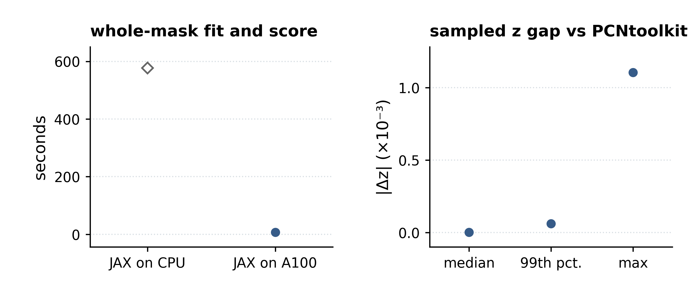

# exp_003 batched fit

## how fast is the batched fit and how closely does it match PCNtoolkit?

one A100 fit and scored the mask in 7.1 s; the maximum z difference on 1,000 pinned voxels was 0.00110.

[how to run, inputs and outputs](docs/details.md)
