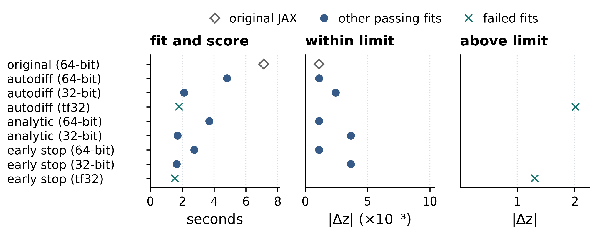

# exp_004 early stop

## can early stopping save time while passing the reference check?

on one A100, 32-bit early stopping took 1.655 s versus 7.128 s for the original, with maximum z error 0.003664.

[how to run, inputs and outputs](docs/details.md)
