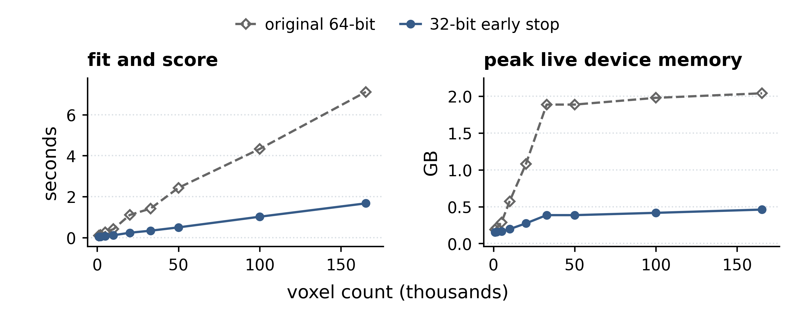

# exp_006 voxel scaling

## how does voxel count change time and device memory?

at 165,402 voxels, 32-bit early stopping used 1.674 s and 0.461 GB; the original 64-bit fit used 7.114 s and 2.040 GB.

[how to run, inputs and outputs](docs/details.md)
