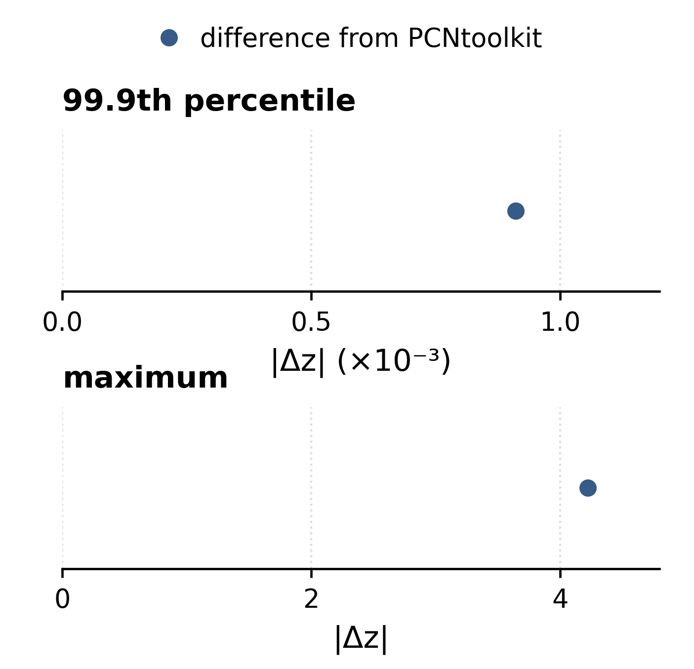

# exp_007 whole-mask agreement

## how closely do the batched and PCNtoolkit scores agree across the full mask?

the 99.9th percentile absolute z difference was 0.000911; the largest gap was 4.22.

[how to run, inputs and outputs](docs/details.md)
