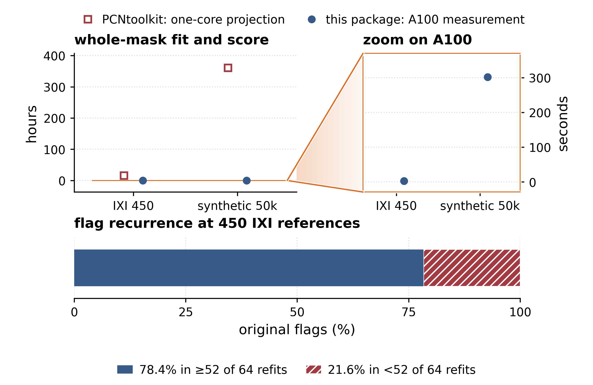

# exp_010 reference size

## how do fit time and original flag recurrence look at these reference sizes?

at 450 IXI references, the A100 took 2.779 s; the one-core PCNtoolkit estimate was 15.873 h.

[how to run, inputs and outputs](docs/details.md)
