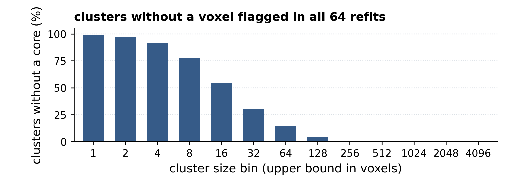

# exp_011 fragile clusters

## do large flagged clusters always have a voxel flagged in every refit?

2 of 2,665 clusters in the 257–512 voxel bin had no voxel flagged in all 64 refits at |z| > 1.96.

[how to run, inputs and outputs](docs/details.md)
