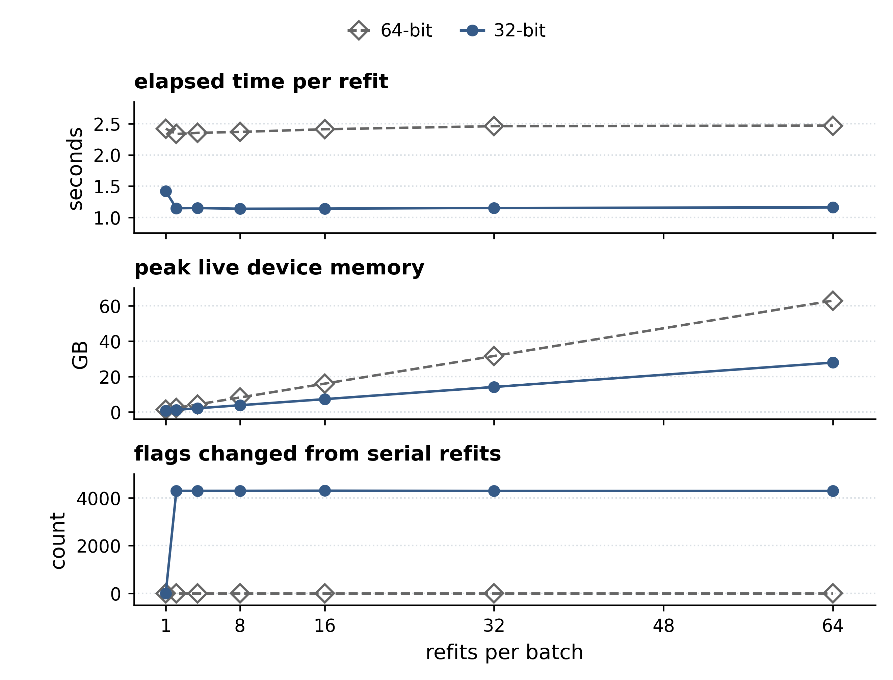

# exp_013 refit batching

## does batching refits save time without changing the flags?

batches of eight cut 32-bit time from 1.418 to 1.138 s/refit but changed 4,298 flags; 64-bit batching changed none.

[how to run, inputs and outputs](docs/details.md)
