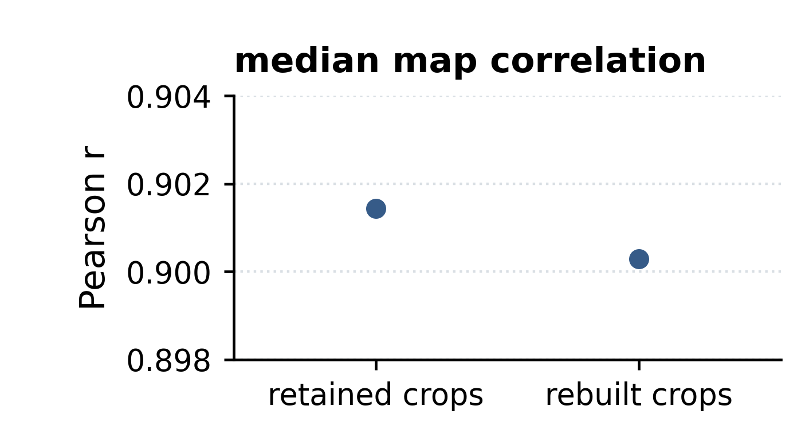

# exp_017 SynthSR quality

## how similar are the grey-matter maps after SynthSR with retained and rebuilt crops?

median map correlation to the leave-one-out mean was 0.9014 for 57 retained crops and 0.9003 for 506 rebuilt crops.

[how to run, inputs and outputs](docs/details.md)
