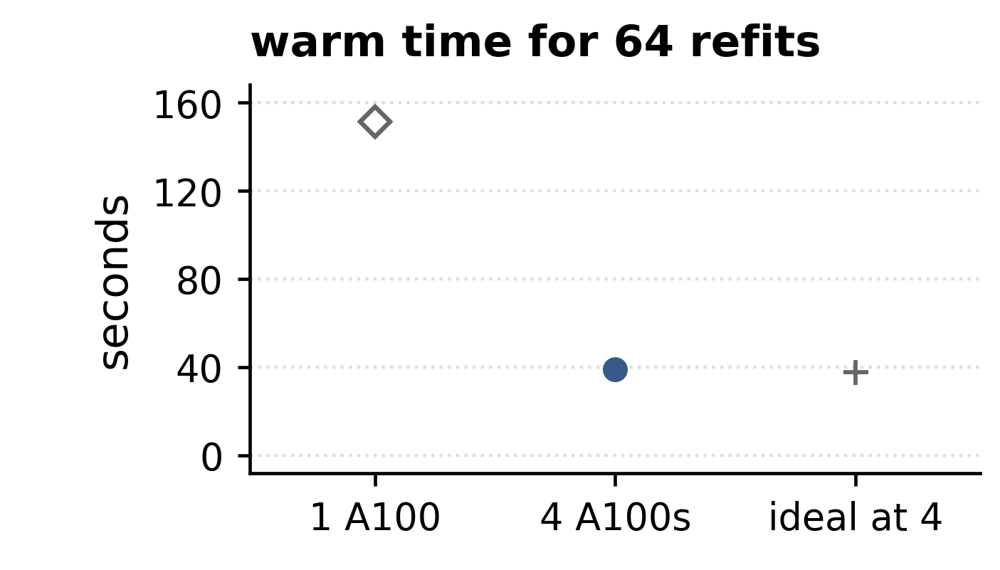

# exp_018 four-A100 refits

## how much faster are four A100s than one for the same 64 IXI refits?

four A100s took 38.91 s versus 151.25 s on one (3.89× faster); all paired z-scores matched bit for bit.

[how to run, inputs and outputs](docs/details.md)
