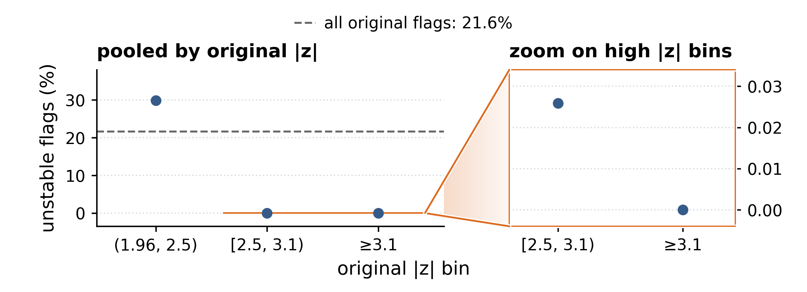

# exp_019 flag stability by |z|

## do flags with larger original |z| recur more often?

unstable shares were 29.9% below |z| 2.5, 0.0259% from 2.5 to <3.1, and 0% at ≥3.1.

[how to run, inputs and outputs](docs/details.md)
