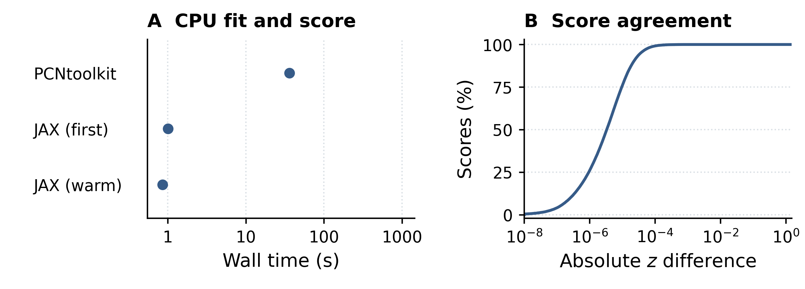

# exp_voxelwisenormative_020_heteroskedastic_blr

## Can batched JAX match PCNtoolkit when noise varies by covariate?

On 1,000 IXI voxels, warm JAX was 42.2× faster than serial PCNtoolkit on CPU; the largest absolute z difference was 0.001124.

[how to run, inputs and outputs](docs/details.md)
