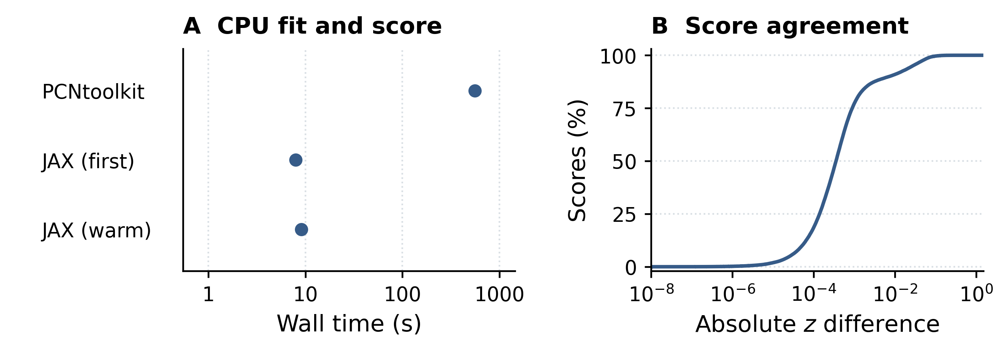

# exp_voxelwisenormative_021_ard_blr

## Does restarting automatic relevance determination fix poor fits on Mac CPU?

Restarts cut voxels with a worse objective from 79 to 1. JAX ran 61× faster; held-out scores still differed.

[how to run, inputs and outputs](docs/details.md)
