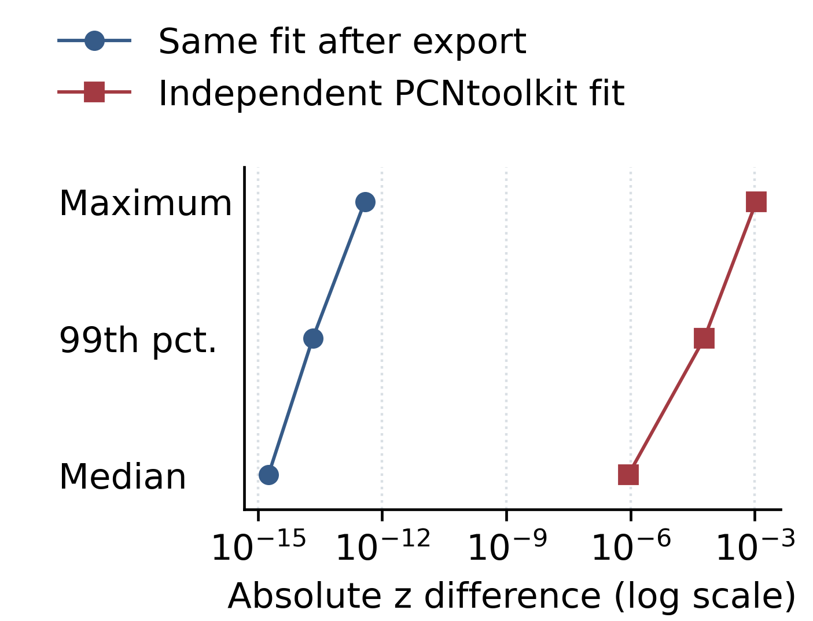

# exp_voxelwisenormative_022_pcntoolkit_export

## Can PCNtoolkit load the JAX fit and reproduce held-out z-scores?

PCNtoolkit reproduced 113,000 held-out IXI scores from the JAX fit with a maximum absolute z difference of 3.81 × 10⁻¹³.

[how to run, inputs and outputs](docs/details.md)
